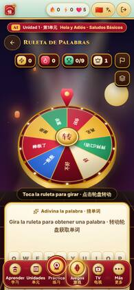
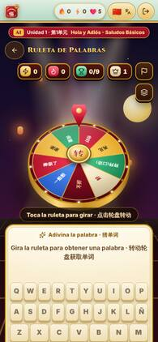
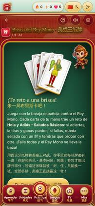
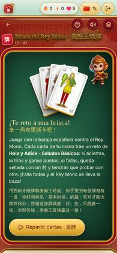
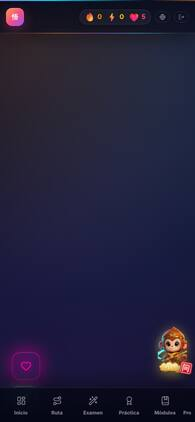
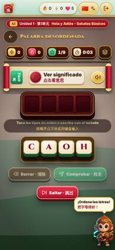
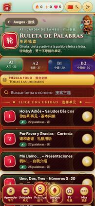

# Auditoría de usabilidad · Wukong Español

Fecha: 21-11-2026 · Rama `claude/auditoria-usabilidad` · Prioridad: móvil (390×844 y 360×780), después escritorio (1366×860).

## Método

- App en local (`VITE_SIN_CLERK=1 npm run dev`, sesión de pruebas) y build de producción (`vite preview`).
- Recorrido automático con Playwright de **46 rutas × 2 tamaños** (móvil táctil y escritorio): errores de consola, desbordes (`scrollWidth > clientWidth`), objetivos táctiles < 44 px, botones sin nombre accesible, texto renderizado y capturas.
- **Partida real de los 17 juegos** en 390×844, 360×780 y 1366×860: elegir unidad → pantalla de juego → elementos tapados por la barra inferior, objetivos < 44 px. Rondas jugadas a mano (Ahorcado, Kahoot, Memory, Palabra desordenada) para ver el feedback de acierto/fallo.
- Navegación: scroll al cambiar de pantalla y al volver atrás, rutas rotas, gesto de deslizar entre secciones.
- Rendimiento con red «4G lenta» (150 ms, 1,6 Mbit/s) y CPU ×4: carga, LCP, CLS, bytes transferidos.

## Resultado general

| Medida | Resultado |
|---|---|
| Desbordes horizontales | **0** en 46 rutas × 2 tamaños y en los 17 juegos |
| Errores de consola / excepciones | **0** |
| CLS (cambio de diseño) | **0** en `/ruta`, `/juegos`, unidad y partidas |
| Carga en 4G lenta + CPU ×4 | ~2,5 s hasta `load`; 0,8–1,4 MB transferidos |
| LCP en 4G lenta | 2,4 s (partida) · 4,6 s (`/ruta`) · 6,3 s (`/juegos`) · 6,7 s (unidad) — lo marcan imágenes **decorativas** de fondo |

La base es sólida (trabajo previo de v14 y «móvil · juegos»): no hay pantallas rotas por desborde ni errores. Los problemas reales estaban en la **barra inferior durante las partidas**, la **gestión del scroll** y **enlaces rotos**.

## Hallazgos priorizados (impacto × esfuerzo)

| # | Impacto | Esfuerzo | Dónde | Hallazgo | Estado |
|---|---|---|---|---|---|
| 1 | Alto | Bajo | Todas las partidas (móvil) | La barra inferior fija (≈90 px) seguía visible jugando: tapaba la fila Q–T del teclado de la **Ruleta**, el botón **«Repartir cartas»** de la Brisca y las disposiciones de **Fichas del palacio**. | ✅ **Modo partida**: en < 1024 px la barra se retira dentro de `/juegos/<juego>` salvo en la elección de unidad (`.jeu`). Cada juego conserva su «←» y la barra superior. |
| 2 | Alto | Bajo | Navegación global | Sin gestión de scroll (HashRouter no trae `ScrollRestoration`): una pantalla nueva podía abrirse a media altura y al volver atrás se perdía la posición (p. ej. lista de unidades, pabellón de juegos). | ✅ `GestorScroll`: arriba al entrar; al volver (atrás/adelante) recupera la posición, reintentando mientras carga la página diferida. |
| 3 | Alto | Bajo | Rutas desconocidas (`#/loquesea`, enlaces viejos) | Pantalla **vacía** con la barra superior e inferior del tema antiguo (azul/morado). | ✅ Ruta comodín → `/ruta` (sin sesión, a la portada). |
| 4 | Medio | Bajo | Brisca (móvil) | El botón principal «Repartir cartas» quedaba fuera de la pantalla bajo el abanico y las reglas. Además `position: sticky` no funcionaba en ningún juego porque `.app-stage` tenía `overflow: hidden`. | ✅ `.app-stage` con `overflow: clip` (mismo recorte) y botón fijo abajo en ≤ 600 px. |
| 5 | Medio | Bajo | Palabra desordenada y demás juegos con el Rey Mono | El bocadillo del Rey Mono tapaba «Comprobar». | ✅ Sin barra inferior, el Mono baja al borde de la pantalla. |
| 6 | Medio | Bajo | Ruleta (móvil) | Rueda grande: el teclado no cabía en la primera pantalla (390×844). | ✅ Rueda ~12 % más pequeña en ≤ 600 px; a 390×844 cabe el teclado completo. A 360×780 asoman 2 filas (al girar, la rueda se compacta). |
| 7 | Medio | Bajo | Gesto de deslizar entre secciones | Recorría un orden distinto al de la barra (`/dashboard → /examenes → /diccionarios…` e incluso `/consejos`, `/ayudas`, ocultas en el menú) y podía dispararse dentro de filas deslizables. | ✅ Mismo orden que la barra inferior (Aprender → Unidades → Práctica → Juegos → TV); se ignora en filas con scroll horizontal y en `canvas`. |
| 8 | Medio | Bajo | Objetivos táctiles en partidas | Pistas de la Sopa 40 px, «Escuchar» de Palabra desordenada 40 px, acciones del UNO 40 px, cabecera del Viaje del Rey Mono 40 px, barra del Pinball 34–36 px. | ✅ 44 px en < 1024 px. |
| 9 | Medio | Bajo | Juegos clásicos con `?m=N` | Abrir a mano (o desde otra pestaña) dos URL `#/juegos/x?m=N` seguidas: la segunda mostraba el selector en vez de la partida (clave «default» compartida). | ✅ La entrada se identifica por clave + ruta. |
| 10 | Medio | Alto | Rendimiento | CSS inicial de **852 KB (161 KB gzip)** bloqueante: `main.jsx` y `LightShell` importan ~25 hojas de todas las secciones. | ⏳ Propuesto (ver «Pendiente»). |
| 11 | Medio | Bajo | LCP | El LCP lo marcaban fondos decorativos que se descubrían tarde (`dragon-luz.webp` del pabellón, `papel.jpg` del mapa de la unidad, `saluda.webp` en la ruta). | ✅ `src/lib/precargaLcp.js`: `<link rel=preload fetchpriority=high>` según la ruta de entrada. 4G lenta + CPU ×4: `/ruta` 4,6 → 3,7 s; `/juegos` 6,3 → ~2,5 s. |
| 11b | Alto | Bajo | 8 juegos (Brisca, Dragón de jade, Fichas del palacio, Mapa mental, Palacio de las palabras, Pincel mágico, Teatro, Viaje del Rey Mono) | `contenidoJuego.js` importaba `ALL_MODULES`: para jugar una unidad se descargaban las 90 unidades completas (~1,4 MB transferidos). *Corrección: la página de unidad ya cargaba solo su unidad; su LCP lo marcan las imágenes del mapa.* | ✅ `unidadJuego.js` + `<ConUnidadJuego>` (App.jsx): solo se descarga la unidad del juego (trozo `unidad-NN`). 4G lenta + CPU ×4, tiempo hasta ver la partida: Brisca 9,0 → 4,9 s · Teatro 8,9 → 4,8 s · Fichas 8,0 → 4,9 s · Viaje 8,0 → 5,1 s; 1,3–1,45 MB → ~0,6 MB. |
| 12 | Bajo | Bajo | Teclados de Ruleta/Ahorcado | Teclas de 28–31 px de ancho × 44 px de alto (como un teclado del sistema). | Aceptado: 10 teclas por fila no caben a 44 px en 360 px. |
| 13 | Bajo | Bajo | Barra superior móvil | Logo y «Salir» a 40×40 px. | ⏳ Pendiente (otra sesión rehace portada/marco). |
| 14 | Medio | Bajo | Diccionario | En móvil, 70 objetivos < 44 px: índice A–Z (40 px), estrella «Guardar en Memoria» (40 px), buscador (42 px), sugerencias «Prueba» (40 px); en tableta horizontal A–Z 34 px y estrella 31 px. | ✅ 44 px en toda pantalla táctil (`pointer: coarse`), también tabletas; la estrella conserva su tamaño visible (borde transparente). Escritorio con ratón sin cambios. |
| 15 | Alto | Bajo | Elegir unidad de los juegos (todas las partidas pasan por aquí) | En móvil la primera unidad aparecía a ~650 px (cabecera grande + 4 puertas de 92 px + «Mezcla todo» + buscador). | ✅ Compactado en ≤ 600 px: primera unidad a ~440 px (390×844) y ~455 px (360×780); se ven 3–4 unidades sin desplazar. Escritorio igual. |
| 16 | Bajo | Bajo | Feedback «哦不!» (`Mascot.jsx`) | Tarjeta con degradados del tema antiguo (verde/azul/naranja). No bloquea toques (`pointer-events: none`). | ⏳ Pendiente de rediseño imperial. |

## Antes / después

| | Antes | Después |
|---|---|---|
| Ruleta (390×844) |  |  |
| Brisca (390×844) |  |  |
| Ruta inexistente |  | Redirige a «Aprender» |
| Palabra desordenada | Bocadillo sobre «Comprobar» |  |
| Elegir unidad (390×844) |  |  |

## Juegos: estado tras la auditoría (móvil 390×844)

Los 17 juegos se abren, eligen unidad y llegan a la partida sin errores ni desbordes. Feedback inmediato comprobado: Ahorcado (teclas verdes/atenuadas + «哦不!»), Memory (fichas giradas + aviso), Kahoot (cuenta atrás + respuesta). Todos tienen «←» visible arriba.

| Juego | Antes | Ahora |
|---|---|---|
| Ruleta | Teclado bajo la barra | Visible entero |
| Brisca | «Repartir cartas» oculto | Fijo abajo |
| Fichas del palacio | Disposiciones bajo la barra | Sin barra |
| Sopa, UNO, Palabra desordenada, Viaje, Pinball | Botones de 34–40 px | 44 px |
| Kahoot, Memory, Dragón de jade, Mapa mental, Teatro, Pincel, Turbo-kart, Palacio, Ahorcado | Correctos | Más espacio útil (sin barra) |

## Ficheros tocados

- `src/components/layout/GestorScroll.jsx` (nuevo) · `src/App.jsx` (gestor de scroll, ruta comodín, gesto de deslizar)
- `src/components/layout/LightShell.jsx` (marca `html.en-juego`) · `src/lib/clasesRaiz.js` (marca `hay-jeu`)
- `src/components/juegos/SelectorTemaJuego.jsx` (arranque con `?m=N`)
- `src/styles/usabilidad.css` (nuevo, cargado tras `movil-marco.css`)
- `src/lib/precargaLcp.js` (nuevo) · `src/main.jsx`
- `src/lib/unidadJuego.js` (nuevo) · `src/lib/contenidoJuego.js` · `src/App.jsx` (`ConUnidadJuego`)

Publicado en `main`: bloque 1 (21-11-2026) bloque 2 (elegir unidad compacto + precarga LCP) bloque 3 (juegos con solo su unidad) y bloque 4 (Diccionario a 44 px).

## Pendiente y decisiones para el dueño

1. **CSS inicial (161 KB gzip, bloqueante)**: mover las hojas de cada sección a su página diferida reduciría la primera carga a la mitad, pero cambia el orden de la cascada y obliga a revisar todas las pantallas. Propuesta: hacerlo por secciones (TV, Diccionario, Pronunciación primero), con capturas antes/después.
2. Barra superior móvil a 44 px (coordinar con la sesión de diseño de portada/marco).
3. El bocadillo de bienvenida del Rey Mono del tutor («¡Hola! Soy el Rey Mono») tapa fichas del Diccionario en el móvil mientras está abierto.
